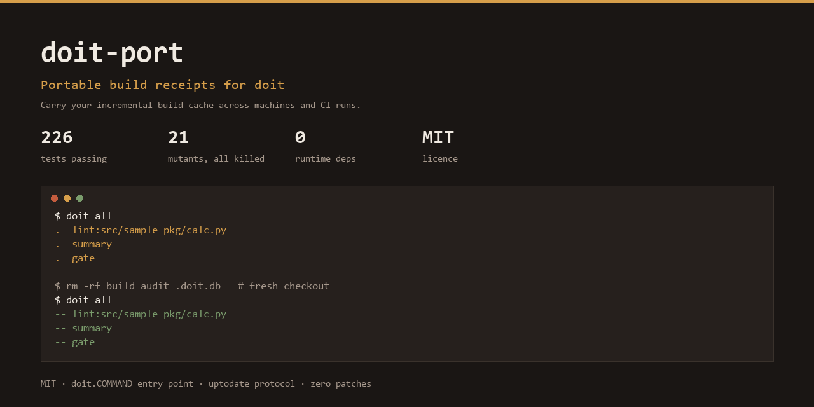

# doit-port



**Portable, content-addressed build receipts for [doit](https://github.com/pydoit/doit).**

`doit` already knows how to skip work it has already done — but only on the
machine, in the directory, and with the `.doit.db` file where it did it. Copy
the project to a colleague's laptop, to CI, or to a fresh checkout, and every
task runs again from zero.

`doit-port` fixes exactly that one thing. It records what each task produced,
from which inputs, using which build steps, and stores the produced bytes so
that a *different* machine can prove the work is already done instead of
redoing it.

```
$ doit                # first run: everything builds
.  lint:src/sample_pkg/calc.py
.  summary
.  gate

$ rm -rf build audit .doit.db     # what a fresh checkout looks like
$ doit
-- lint:src/sample_pkg/calc.py    # restored from receipts, no work done
-- summary
-- gate
```

---

## What it does *not* do

Due respect to `doit`: it is a good, small, well-designed tool. Everything below
is a deliberate boundary, not a complaint.

Being explicit about the boundary matters more than the feature list.

* It does not re-implement `doit`'s scheduler, dependency resolver, or CLI.
  There is no patched `doit` and no vendored copy of it.
* It does not replace `doit`'s own incremental logic. Tasks that do not use
  `port_task()` keep behaving exactly as before, including `file_dep` and
  `.doit.db`.
* It does not make an action deterministic. If your action writes a timestamp
  into its output, the bytes differ every time and nothing can be reused. That
  is your action's problem, and the receipts will honestly show it.
* It is not a remote cache server. It moves a cache as a directory or a ZIP;
  sharing it over HTTP is left to you (`doit port export` is the seam for it).
* It does not support directory targets, `basename`-less sub-task generators
  with ambiguous names, or tasks with no declared targets. Those are refused
  with an explanation rather than half-supported.

## What it adds

| Piece | Where it plugs in | Why that is legal |
|---|---|---|
| Per-task "is it up to date?" decision | `task['uptodate']` — doit's documented hook, called before its own file checks | Public protocol; `doit`'s own `result_dep` uses the same slot |
| `doit port` sub-command | `doit.COMMAND` entry-point group | None of doit's code is touched; `DoitMain.get_cmds()` loads this group by design |
| Task metadata | `task['meta']['port']` | Documented as "extra info from user/plugin not directly used by doit" |

Requires Python ≥ 3.10 and `doit` ≥ 0.36. No third-party runtime dependencies.

## Install

```bash
pip install doit-port          # from a wheel, see dist/
pip install -e .               # from a source checkout
```

## Use it

```python
# dodo.py
from doit_port import port_task

def task_lint():
    # a plain `return` describes the task itself, so use basename=
    return port_task(
        basename="lint",
        actions=[["python", "tools/lint.py", "--out", "build/lint.json"]],
        targets=["build/lint.json"],
        inputs=["src/app.py", "tools/lint.py"],
    )

def task_report():
    return port_task(
        basename="report",
        actions=[["python", "tools/report.py", "build/lint.json", "build/report.md"]],
        targets=["build/report.md"],
        # build/lint.json is both an upstream task and an actual input file:
        # declare it as an input so the key covers its *contents*
        inputs=["tools/report.py", "build/lint.json"],
        task_dep=["lint"],
    )
```

```bash
doit                          # run
doit port status              # what is cached, and is it intact?
doit port verify              # re-hash every artefact referenced by a receipt
doit port export ../cache     # write a portable bundle
doit port import ../cache     # verify, then merge a bundle (e.g. on CI)
doit port gc --dry-run        # what would be dropped
doit port forget lint         # drop receipts for one task
```

`port_task()` signature: `name` *or* `basename`, `actions`, `targets`,
`inputs`, `task_dep`, `key_salt`, `uptodate`, plus any other documented doit
task attribute. `file_dep` is **rejected** — see
[docs/design.md](docs/design.md#why-file_dep-is-refused).

### Sub-task groups

If the list of subtasks comes from a config file rather than a literal, group
them with `port_group()`:

```python
from doit_port import port_group, port_task

def task_lint():
    return port_group("lint", [
        port_task(name=m, actions=[...], targets=[...]) for m in MODULES
    ])
```

It re-files each spec under the name doit actually registers (`lint:<module>`)
and yields the subtasks, which is what doit expects from a generator.

## Configuration

Merged in increasing priority: defaults → `pyproject.toml` `[tool.doit_port]` →
`doit-port.toml` → `DOIT_CONFIG['doit_port']` in `dodo.py`.

```toml
# doit-port.toml
[doit_port]
store = ".doit-port"    # where receipts and artefact bytes live
flavor = "default"      # bump to invalidate everything (e.g. a new pipeline)
on_drift = "rebuild"    # rebuild | warn | restore -- see below
max_blob_mb = 256       # artefacts above this are digested but not stored
bundle_include_objects = true
```

`on_drift` decides what happens when an artefact on disk is *not* what the
receipt says it should be:

* `rebuild` (default) — run the task again; the correct, boring choice.
* `warn` — same, with a warning on stderr.
* `restore` — overwrite the file with the recorded bytes. Use this when the
  workspace is a mirror of the cache and a wrong artefact is purely damage.

## How a decision is made

For every ported task, before doit runs anything:

1. **Hash the inputs.** `inputs=` files, by content.
2. **Hash the upstream artefacts.** For each entry in `task_dep=`, the combined
   digest of what that task produced. This is what gives *early cutoff*: if an
   upstream task re-ran but produced identical bytes, nothing downstream moves.
3. **Hash the build steps.** The bytecode of each Python action (not its source
   text: comments and line numbers do not count), or the command string of a
   shell action. Plus the declared targets, a user `key_salt`, and the
   `doit` / `doit-port` / Python minor versions.
4. **Look up a receipt** under that key. Found and its blobs are all intact?
5. **Compare the disk** with the receipt: identical → *hit*; missing or
   different-but-previously-produced → restore or rebuild (see `on_drift`).

If any step cannot be completed, the hook returns "not up to date" and doit
runs the actions. It never returns "up to date" without being able to show the
bytes.

Full reasoning, including the failure modes that shaped it, is in
[docs/design.md](docs/design.md).

## Example

[`examples/codeaudit`](examples/codeaudit) is a four-stage audit pipeline over a
small, deliberately imperfect Python package:

```
lint:<module>  ->  audit/<module>.json     AST audit, one sub-task per module
summary        ->  build/audit.json/.md    merge
gate           ->  build/gate.txt          fail when the finding budget is blown
```

```bash
cd examples/codeaudit
doit all                       # first pass
doit all                       # all "--"
# edit one module, then:
doit all                       # only that module is re-audited
```

What the tests actually verify there (see
`tests/test_example_codeaudit.py`, which drives the CLI as a subprocess):

* editing one module re-audits **only** that module;
* a comment-only edit stops at the lint stage — the artefact is unchanged, so
  `summary` and `gate` keep their receipts;
* deleting `build/`, `audit/` **and** `.doit.db` restores everything instead of
  rebuilding;
* lowering the budget in `audit.toml` makes `gate` fail, leaves **no**
  `build/gate.txt` and **no** receipt for `gate`; raising it again re-runs
  `summary` and `gate` only.

## Credits

`doit` is by [Eduardo Naufel Schettino](https://github.com/schettino72) and its
contributors, MIT licensed. `doit-port` exists because that design is small
enough to extend from the outside instead of forking — which is the highest
compliment a framework can get.

## Verification

```
$ pytest -q                    # 215 tests, 1 skipped (symlink privilege)
$ python tools/mutation_check.py
baseline: green
[ 1/21] targets-not-restored               killed
...
all 21 mutants killed
```

The mutation run is the part that matters: it applies plausible bugs (dropping
the input digest from the key, claiming a hit without restoring, accepting a
corrupt blob, re-importing a tampered bundle…) and fails if the suite does not
notice. Two real gaps were found this way and are now covered.

## Limits worth knowing

* **Re-running is not always avoidable.** After a revert, the artefact on disk
  belongs to the newer build, so the stage is re-run rather than replayed. It is
  cheap and it keeps the graph honest; guessing would be neither.
* **`doit --always` writes no receipts** (it skips the `uptodate` hooks, so the
  action signature was never observed). This is deliberate.
* **`--parallel` / multiprocessing** is untested. The hook itself is re-entrant
  and the store is atomic, but that claim is not backed by a test.
* **Receipts are as good as your `inputs=`.** If an action reads a file you did
  not declare, a change to that file will not be seen. The API cannot fix this;
  it can only refuse to pretend.
* **No pruning by age.** `doit port gc` keeps everything that any receipt
  references. Long-lived caches grow; delete receipts first (`forget`).

## Licence

MIT. `doit` itself is MIT (© Eduardo Naufel Schettino) and is used as a
dependency, not copied — see [LICENSE](LICENSE).
